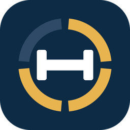

# TrainingAssistant

*Deutsche Fassung: [README.de.md](README.de.md)*

A Home Assistant integration (installable via HACS) for strength training with a
focus on hypertrophy and *progressive overload*.

You work through a training plan and log every set without typing: by button and
voice. Your voice satellite announces the next exercise and asks after each set
"10 reps with 16 kilos as planned?". A button press means *yes*; you only need to speak
if something was different ("only eight"). A dashboard card shows live where you are,
and you can correct sets there with a tap. From your history the integration calculates
weight and reps for the next session.

**Languages:** English and German – card, announcements, voice answers, error messages,
guide and templates. The language follows your Home Assistant profile (fallback: English);
the voice language can also be set in the integration options.

## What's included

| Part | Content |
|---|---|
| **Flow** | Warm-up, sets (5x5, 3x8–12), circuits, HIIT, timed flows (yoga, 30-20-10), cool-down · circuits with a time cap ("alternate for 5 minutes") · sets up to a total · `max` sets · per side · tempo · rest timer · undo, skip, pause |
| **Voice** | Announcements and questions via an Assist satellite (`assist_satellite.ask_question`), spoken numbers in English and German ("twelve and a half kilos", "eight times fifteen", „zwölfeinhalb Kilo“) |
| **History** | Every set stored permanently (not in the HA recorder) · suggestions via double/linear/rep progression · editable afterwards |
| **Effort** | Say "eight, that was hard" or tap *Easy / Normal / Hard*: hard = no increase next time, all easy = bigger step |
| **Records** | New personal bests (weight, estimated max, reps, time) are announced ("New record!"), marked with 🏆 and fired as an event |
| **Statistics** | Week view ("3 of 4 workouts this week" with days and muscle groups), weekly goal, streak, training time, sets per muscle group per week, recovery status per muscle group |
| **People** | Several people on one tablet: each has their own history, suggestions, weekly goal and program position; plans are shared |
| **Exercise images** | Photos (start/end) from [free-exercise-db](https://github.com/yuhonas/free-exercise-db) (public domain), matched automatically; downloaded once on plan import, served locally afterwards |
| **Card** | `custom:training-assistant-card` with the tabs Training, History and Plans, loaded automatically |
| **Entities** | Buttons *Start, Next, Undo, Pause, Skip, Finish, Abort, Reps/Weight up/down, Rest longer/shorter (±15 s)* · numbers *Reps, Weight* (e.g. for a rotary knob) · selects *Person, Program, Next workout* · sensors *Status, Current exercise, Progress, Last set, Workouts this week, Streak* · calendar *Workouts* |
| **Blueprints** | Zigbee button · start a workout by voice · signals for HIIT/rest (sound, light) |

The integration deliberately knows **no hardware**. A button "presses" the button entities
(blueprint), and the voice satellite is passed in when a workout starts. Without devices the
workout runs silently on the card.

## Installation

1. HACS → ⋮ → *Custom repositories* → `https://github.com/Calmageddon/TrainingAssistant`, type *Integration*
2. Install TrainingAssistant, restart Home Assistant
3. Settings → Devices & services → *Add integration* → TrainingAssistant
4. Edit dashboard → Add card → **TrainingAssistant** (or `type: custom:training-assistant-card`)

Requires Home Assistant 2025.7 or newer.

**Options** (integration → *Configure*): default satellite, announcements on/off,
questions on/off, time to wait for an answer, voice language (automatic, English, German),
phone notification (a `notify` service such as `mobile_app_…` for the end of rest and new records).

## Privacy

When a plan is imported, Home Assistant downloads the matching exercise images once from
`raw.githubusercontent.com` and stores them under `<config>/training_assistant/images/`.
Nothing is loaded from the internet when the card is displayed.

## Training plans

**Templates:** 33 proven programs are included (strength & hypertrophy, bodyweight without
equipment, calisthenics from beginner to advanced, kettlebell, HIIT & Tabata, endurance, yoga & mobility). Add them in the card under
*Settings → Templates*; overview and sources: [docs/templates.md](docs/templates.md).

Your own plans are pasted as YAML/JSON into the card (*Settings → Own plan*). The card offers a
guide and an example plan for download. Format, examples and a ready-made prompt for
ChatGPT/Claude: [docs/plan-format.md](docs/plan-format.md).

## Usage

| Button (blueprint default) | Effect |
|---|---|
| single press | set done / next · during a question: "as planned" · without a workout: start the next workout |
| double press | undo (one step back, discard the set logged there) |
| long press | pause / resume |

Voice start: blueprint *Start a workout by voice*, e.g. "Hey Jarvis, training protocol".
Questions and announcements then go through exactly that satellite.

Satellites must support `ask_question`, i.e. be able to start a conversation on their own. This
works e.g. with the Voice PE, ESPHome satellites and *Kiosk Satellite* (also on the Echo Dot 2
with LineageOS).

### Importing blueprints

Settings → Automations & scenes → Blueprints → *Import blueprint*:

- `https://github.com/Calmageddon/TrainingAssistant/blob/main/blueprints/automation/training_assistant/button.yaml`
- `https://github.com/Calmageddon/TrainingAssistant/blob/main/blueprints/automation/training_assistant/voice_start.yaml`
- `https://github.com/Calmageddon/TrainingAssistant/blob/main/blueprints/automation/training_assistant/signals.yaml`

(For a private repo: copy the file content and save it under `config/blueprints/automation/`.)

### Actions and events

Actions: `training_assistant.start`, `next`, `undo`, `skip`, `pause`, `finish`, `abort`,
`adjust`, `set_value`, `import_plan`, `delete_plan`, `set_program`, `set_next_workout`, `log_set`,
`edit_set`, `get_history`, `get_stats`, `rest_adjust`, `set_profile`. `next`, `log_set` and `edit_set`
accept `effort` (`easy`, `normal`, `hard`).

**People:** Add people under *Settings → People*. "Who's training?" appears above the start button as
soon as there is more than one person (also as the select entity *Person* and the action
`set_profile`, e.g. for an NFC tag per person). Switching is not possible during a workout.
People are not Home Assistant users, so guests don't need an account. Optionally an admin can link a
person to a Home Assistant user (*Settings → People*): when that user opens the card, e.g. on their own phone,
their person is selected automatically (once on opening, never during a workout).

**Programs:** You move within an *active program*. After each finished workout the next workout
of that program is queued, after the last one the first again. Every program remembers its
position: if you briefly switch to another one (select "Program") and back, you continue where
you left off. A single workout from another program can be started via *Settings → My plans → Start* without
changing the active program.

Event `training_assistant_event` with `type`: `session_started`, `step`, `set_logged`,
`set_answered`, `rest_over`, `time_cap_over`, `interval_work`, `interval_rest`,
`interval_done`, `paused`, `resumed`, `undo`, `record`, `session_finished`.

## Adding a language

- Card: add an entry to `I18N` at the top of `frontend/training-assistant-card.js`
- Announcements: `phrases.py` · spoken numbers and answer words: `spoken.py`
- UI texts and error messages: `translations/<lang>.json`
- Plan validation messages: `EN_MESSAGES` in `plan.py` (German is the source text)

## Development

```bash
scripts/setup        # once: Python environment with Home Assistant (needs uv)
scripts/develop      # test instance on http://localhost:8123
.venv/bin/python -m pytest tests            # logic tests
.venv/bin/python tools/e2e_test.py          # end-to-end test against the running test instance
.venv/bin/python tools/validate_plan.py my-plan.yaml
.venv/bin/python tools/build_guide.py       # rebuild the guides after changing docs/plan-format*.md
```

The test instance includes a test satellite (`scripts/dev_components/fake_voice`) that
answers questions with predefined sentences.
